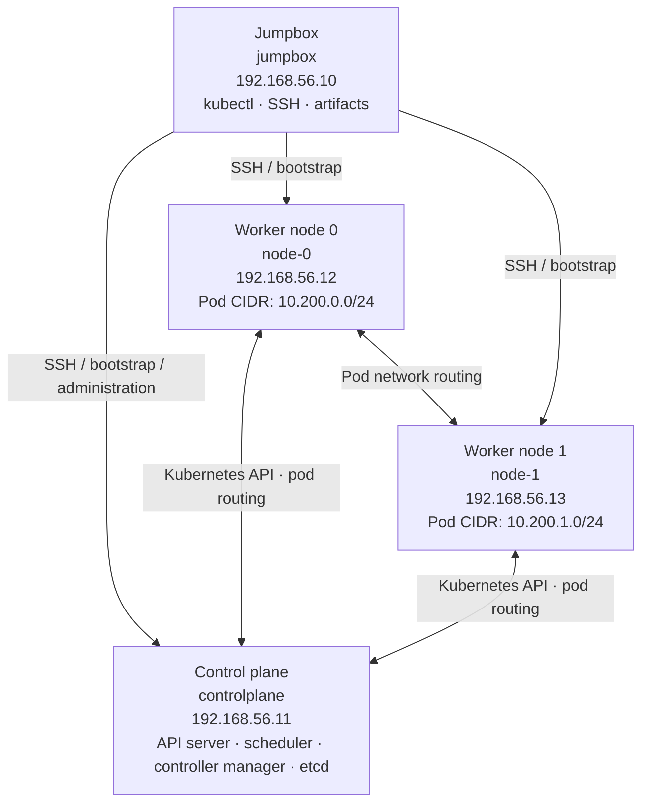

# Kubernetes Manual Cluster

This repository contains shell scripts for building a small Kubernetes cluster by hand, following the general approach of [Kubernetes The Hard Way](https://github.com/kelseyhightower/kubernetes-the-hard-way). The scripts automate pieces of the work on a jumpbox and over SSH to a control plane, an etcd host (currently named `controlplane` in the script), and two worker nodes.

> **Status:** These scripts are a work in progress. They are not a one-command installer, and the repository currently contains scripts but not all of the configuration files, systemd unit files, machine inventory, or templates they expect. Review and adapt every command for your operating system, Kubernetes version, network, and VM provider before running it.

## Architecture

The diagram shows the intended lab topology inferred from the scripts. The scripts currently use the control plane as the etcd target; verify whether etcd is meant to be colocated or moved to a dedicated VM before deployment.



The addresses and pod CIDRs above are hard-coded examples from the scripts, not a required or validated network plan. See [Intended lab shape](#intended-lab-shape) before using them.

## What the scripts cover

| Script | Intended role | Important notes |
| --- | --- | --- |
| `setup-jumpbox-opt.sh` | Install packages, clone the upstream repository, download and unpack Kubernetes, etcd, container runtime, and CNI binaries. | Runs `apt-get upgrade -y`, downloads versioned artifacts, removes downloaded archives, and installs `kubectl` under `/usr/local/bin`. Review versions and source checksums before use. |
| `setup-jupmpbox..sh` | Earlier jumpbox setup attempt. | Retained alongside the optimized script; it has apparent command/path typos and should not be assumed to work. Prefer reviewing and consolidating before use. |
| `ssh_config_on_vms.sh` | Install/configure SSH and distribute a root SSH key. | Permits root SSH login and creates an unencrypted root private key. Use only on an isolated lab network and replace this with restricted, short-lived credentials for anything beyond a disposable lab. |
| `hostnames.sh` | Add fixed host/IP entries and set remote hostnames. | Hard-codes `192.168.56.10`–`.13`; confirm these addresses belong to your private lab network. It edits `/etc/hosts` locally and remotely. |
| `certscript.sh` | Earlier certificate generation and worker certificate copy. | Creates long-lived CA and component keys; it can regenerate material. Inspect its behavior and protect the `certs/` directory. |
| `certscriptfinal.sh` | Generate/check certificates and optionally copy them to nodes and control plane. | Supports `--no-copy`, `--force`, and `--new-ca`. `--force` replaces component certificates; `--new-ca` invalidates trust in certificates signed by the old CA and can take the cluster offline until all components are updated. |
| `controlplane_services.sh` | Generate an API server key, CSR, and certificate using `ca.conf`. | Uses the CA private key. Keep that key offline or tightly protected when possible. |
| `generating_keys06.sh` | Generate an encryption configuration and copy it to the control plane. | The encryption key protects Kubernetes secrets at rest. Back it up securely; losing it can make stored secrets unreadable. Replacing it requires a planned data migration. |
| `configuration-05.sh` | Earlier kubeconfig generation and distribution attempt. | Appears incomplete/buggy (for example, inconsistent variable names in the copy function). Treat as a reference, not a reliable run target. |
| `configuration-05final.sh` | Build and verify kubeconfigs, distribute them, optionally restart services. | Supports `--no-copy` and `--restart`. Kubeconfigs embed private keys and are credentials; keep permissions restrictive. Restarting services can cause downtime. |
| `bootstrapping_etcd07.sh` | Copy etcd artifacts/configuration and start etcd on the target. | Despite its name, the script sets `host=controlplane`. Verify this is the intended etcd location and that its unit file, certificates, and directories agree. |
| `btscp.sh` | Earlier control-plane bootstrap attempt. | Duplicates much of `bootstrapping_controlplane08.sh`; inspect before use. |
| `bootstrapping_controlplane08.sh` | Install control-plane binaries, files, and systemd services; run basic checks. | Requires prepared files on the jumpbox and can install/start privileged system services remotely. |
| `bootstrapping_nodes09.sh` | Render worker configuration templates and copy them to nodes. | Expects `machines.txt`, `configs/10-bridge.conf`, and `configs/kublet-config.yaml`. The script uses an undefined `${HOST}` while deriving subnets; fix and review before running. |
| `pod_network11.sh` | Add routes between worker pod subnets. | Changes kernel routes on the control plane and node-1. Route changes may disrupt traffic; the script also ends by opening interactive SSH sessions to all hosts. |
| `configure_kubectl10.sh` | Earlier jumpbox kubectl configuration/check attempt. | Contains apparent flag/command errors and should be treated as unfinished. |

Script names with numeric prefixes suggest an intended sequence, but they are not a complete, validated orchestration. The repository does not include the expected `configs/`, `units/`, `machines.txt`, certificate configuration, or the upstream checkout contents, so fill in and verify those inputs first.

## Intended lab shape

The scripts currently assume these host aliases and addresses in `hostnames.sh`:

| Role | Host alias | Example address | Pod subnet shown in scripts |
| --- | --- | --- | --- |
| Jumpbox | `jumpbox` | `192.168.56.10` | — |
| Control plane (also used as etcd target in one script) | `controlplane` | `192.168.56.11` | — |
| Worker | `node-0` | `192.168.56.12` | `10.200.0.0/24` |
| Worker | `node-1` | `192.168.56.13` | `10.200.1.0/24` |

These are examples embedded in code, not a portable network plan. Ensure the addresses do not overlap with your LAN, VPN, host-only network, pod/service CIDRs, or routes already present on the machines. Update all dependent host files, certificates/SANs, kubeconfigs, inventory, and routes together when changing them.

## Prerequisites

- A disposable, private lab environment with a jumpbox, one control-plane VM, and two worker VMs. Verify CPU, memory, and disk capacity against the versions and workload you choose; this repository does not specify a tested minimum or production sizing.
- A supported Linux distribution compatible with the package commands and service assumptions in the scripts (many use Debian/Ubuntu tools such as `apt`, `dpkg`, and systemd).
- Network connectivity between the VMs for SSH and the Kubernetes/control-plane, etcd, node, and pod traffic required by your chosen configuration. Restrict inbound access with host/cloud firewalls; do not expose the API server or SSH broadly to the internet.
- Working name resolution for `controlplane`, `node-0`, and `node-1`; passwordless SSH configured only after you understand the root-access implications.
- The upstream checkout and local inputs expected under `/home/jumpbox/kubernetes-the-hard-way`, including `configs/`, `units/`, `certs/ca.conf`, templates, and `machines.txt`.
- Reviewed binary versions and trusted download sources. Where available, verify published hashes/signatures before installation.
- Console or provider access to recover a VM if SSH, networking, or systemd configuration breaks.

## Suggested workflow

This is a review checklist, not a guaranteed execution order. Resolve the script issues and validate the inputs before running commands.

1. **Plan the lab.** Choose a private network and non-overlapping node, service, and pod CIDRs. Decide whether etcd is colocated on the control plane or runs separately; the current scripts are inconsistent about this.
2. **Create and baseline VMs.** Install a compatible Linux OS, set resource limits, update the OS deliberately, and record VM names, addresses, disk sizes, and snapshots. Avoid running `apt upgrade -y` blindly on long-lived systems.
3. **Prepare the jumpbox.** Review `setup-jumpbox-opt.sh`; verify the upstream source and binary versions before downloading. Check available disk space because downloads and extracted binaries coexist during setup.
4. **Set hostnames and connectivity.** Review and adapt `hostnames.sh`. Confirm name resolution and SSH connectivity manually before allowing scripts to make remote changes.
5. **Prepare and inspect PKI inputs.** Create and review `ca.conf`; generate certificates with one selected certificate workflow. Protect the CA key, service-account keys, encryption key, and kubeconfigs. Back up recovery material securely.
6. **Generate kubeconfigs and encryption config.** Use the final scripts only after reviewing their target paths and identities. Verify that embedded certificates and API endpoints match your cluster.
7. **Install runtime and node/control-plane configuration.** The repository currently lacks several required scripts and files. Complete and review these before bootstrapping; confirm systemd unit flags, certificate paths, and service dependencies.
8. **Configure routes/networking.** Inspect `pod_network11.sh` and make sure routes are correct and persistent if required. Verify pod and service CIDRs do not overlap other networks.
9. **Bootstrap services and verify manually.** Start etcd before the API server, then controllers/scheduler and worker services as appropriate for your configuration. Check `systemctl`, logs, `etcdctl`, API health, and `kubectl get nodes` after each stage.
10. **Record teardown and recovery.** Keep an inventory of resources, snapshots, keys, and cleanup steps before deploying workloads.

Run shell syntax checks and inspect scripts before executing them, for example:

```bash
bash -n ./certscriptfinal.sh
sed -n '1,240p' ./certscriptfinal.sh
```

Syntax checks do not validate remote paths, credentials, networking, or the effects of commands. Do not run every `*.sh` file in a loop.

## Compute resource management: warnings and cautions

### VM sizing and capacity

- Set CPU, RAM, and disk limits per VM before bootstrapping. Leave headroom on the host for its own operating system and other VMs; oversubscribing memory can cause swapping, timeouts, node pressure, and service failures.
- Monitor CPU, memory, disk usage, and I/O on both the host and guests. Kubernetes components and etcd are sensitive to sustained disk latency and memory pressure. Do not interpret an unresponsive API as proof that more CPU alone is needed; inspect logs and resource metrics first.
- Reserve adequate disk space for the OS, container images, logs, etcd data, and upgrades. Set a plan for image garbage collection and log rotation. Never delete `/var/lib/etcd` or Kubernetes state directories as casual cleanup; that can destroy cluster state.
- A two-worker lab has little spare capacity. If one worker is stopped or overloaded, workloads may remain pending or become unavailable. This layout is for learning, not high availability.
- Avoid placing important workloads on the jumpbox. It is an administrative host and often holds powerful credentials and downloaded artifacts.

### Cloud cost and lifecycle

- If these VMs run in a metered cloud, stopped VMs may still incur charges for disks, snapshots, public IPs, reserved addresses, and other attached resources. Check your provider's billing rules and budget alerts before creating resources.
- Tag/name resources by role and environment, record their IDs, and set a teardown reminder. Delete only resources you positively identify as belonging to this lab; deleting a VM may not delete its disks or snapshots.
- Snapshot before major OS, certificate, runtime, or network changes when the provider supports it. A snapshot is not a substitute for a tested backup, especially for a live etcd data directory.
- Scale CPU/RAM/disk only during a planned maintenance window if your VM platform requires shutdown to resize. Confirm filesystem/partition expansion steps before increasing virtual disk size.

### Operational safety

- The scripts use `sudo`, root SSH, `scp`, `systemctl`, package installation, and filesystem moves. A wrong host alias or IP can modify the wrong machine. Confirm `hostname`, address, and SSH host key before running a remote bootstrap.
- `ssh_config_on_vms.sh` enables root login and generates an unencrypted root key. Do not reuse that key or expose it in source control, backups, logs, or shared directories. Prefer a dedicated automation account with narrowly scoped sudo and key-based access.
- Avoid placing private keys or kubeconfigs in Git. Restrict permissions (typically `0600` for private keys/config credentials), limit access, and rotate credentials if exposed. Treat shell tracing (`set -x`) output as potentially sensitive.
- Certificate replacement, CA replacement, encryption-key replacement, service restarts, route changes, and package upgrades can cause outages or make existing data inaccessible. Back up first and change one layer at a time with a recovery path.
- Bind the Kubernetes API to trusted interfaces and use firewall rules. The scripts use port `6443`; do not make it public just to simplify access. Restrict etcd access to cluster members.
- This is a manually assembled educational cluster and does not include production hardening, automated patching, monitoring, backups, access controls, or a tested disaster-recovery plan.

## Known issues to resolve before relying on the scripts

These are observations from the current files; the list may not be exhaustive:

- The scripts expect a `/home/jumpbox/kubernetes-the-hard-way` tree that is not included here. Several configuration and unit files are referenced but absent.
- `bootstrapping_etcd07.sh` targets `controlplane`, despite its etcd-specific name. Confirm the intended topology and make the service's certificates and endpoints consistent.
- `bootstrapping_nodes09.sh` uses `${HOST}` when looking up each worker subnet, although that variable is not set in the loop; likely intended to use the current host variable.
- `configuration-05.sh` has inconsistent variables in `copy_kubeconfig` and appears unfinished. `configure_kubectl10.sh` includes misspelled/incorrect kubectl options and commands.
- `setup-jupmpbox..sh` contains apparent extraction command/path typos. Prefer a corrected, consolidated setup script after verifying each artifact and command.
- `pod_network11.sh` adds routes but does not persist them across reboot, and ends with interactive SSH calls. Confirm whether that is intentional and add a network-specific persistence method if needed.
- `hostnames.sh` has a root-check expression that appears malformed and uses hard-coded addresses. Correct it and make host updates idempotent before use.
- Some scripts have legacy and “final” variants with different behavior. Choose one reviewed path and avoid running both against the same cluster without understanding their effects.

## Troubleshooting starting points

- **SSH/name lookup:** Check `/etc/hosts` or DNS, `getent hosts <name>`, firewall rules, and `ssh -vv root@<host>`.
- **Service not active:** Inspect `systemctl status <service> --no-pager` and `journalctl -u <service> -n 100 --no-pager`; confirm referenced files, owners, permissions, flags, and endpoint addresses.
- **API unavailable:** Confirm etcd health first, then API server service/logs, certificate SANs and trust chain, and TCP reachability to port `6443`.
- **Node not Ready:** Check kubelet and container runtime service status, kubelet identity/certificate, CNI configuration, routes, and free memory/disk.
- **Disk or memory pressure:** Identify the consuming process or directory before cleanup. Do not remove etcd data, certificates, kubeconfigs, or runtime state blindly.

## Contributing / finishing the project

Before treating this repository as reproducible, add the missing inventory/configuration and service files, choose one authoritative version of each script, parameterize IPs and paths, add preflight checks, and document a tested end-to-end run and teardown for a specific VM environment. Keep secrets, generated credentials, and environment-specific state out of version control.
